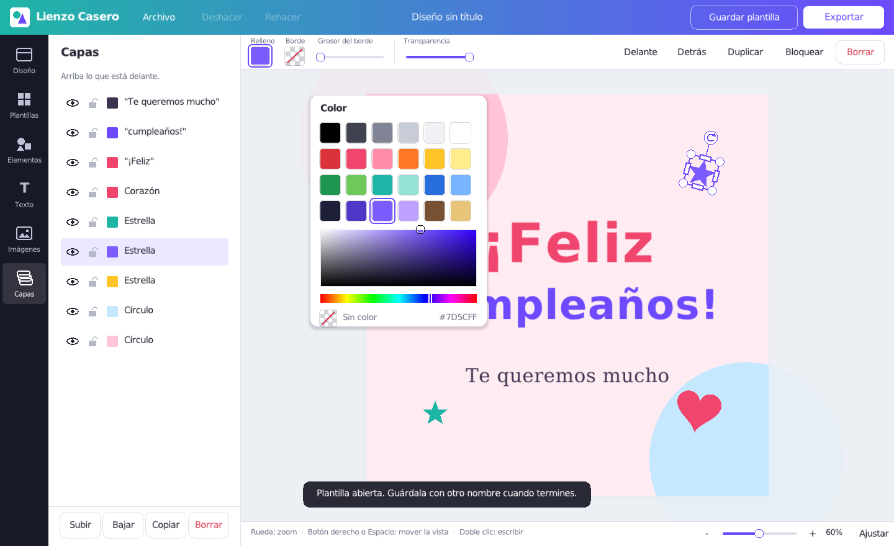

# Lienzo Casero

Programa de diseño sencillo para usar en casa, inspirado en la forma de trabajar de Canva:
plantillas a la izquierda, lienzo en el centro y una barra arriba que cambia según lo que
tengas seleccionado. Está hecho en **C** con [raylib](https://www.raylib.com/) y funciona
sin internet en **Windows 10 y 11 (64 bits)**.



## Qué se puede hacer

- **Plantillas**: 6 de ejemplo (cumpleaños, invitación, Navidad, lista de la compra,
  menú semanal, nota para la nevera) y las tuyas propias con "Guardar plantilla".
- **Textos** con tamaño, color y alineación. Doble clic para escribir.
- **Fuentes**: 45 gratuitas incluidas (Lobster, Pacifico, Bebas Neue, Playfair, Lato, Lora, Baskerville, Garamond, Roboto...),
  las de Windows y las que tú añadas (.ttf u .otf de fonts.google.com, dafont.com...).
  Una fuente añadida viaja dentro del diseño: al abrirlo en otro ordenador se instala sola.
- **Efectos de texto**: sombra, contorno, relieve 3D, grabado y neón, con color e intensidad.
- **Formas**: rectángulo (también con esquinas redondeadas), círculo, triángulo, estrella,
  corazón, línea y flecha. Con relleno, borde y transparencia.
- **Dibujos**: 140 dibujos de colores en 10 temas (fiestas, amor, animales, comida, Navidad...).
  También se pueden abrir dibujos **SVG**, **EPS** y **AI** propios, por ejemplo los de vector4free.com o vecteezy.com.
  Al abrir un SVG puedes elegir: **entero**, **por partes** (cada bloque del dibujo es una
  capa que se mueve y se borra por separado) o **por partes y colores** (además, cada color
  es una capa a la que se le puede cambiar el color). Se respetan los recortes de Illustrator.
- **Importar PDF** (por ejemplo, un diseño descargado de Canva): cada foto, dibujo y texto
  sale como una capa suelta, y los textos se pueden reescribir. Menú *Archivo > Importar PDF*
  o arrastrando el PDF a la ventana.
- **Lápiz mágico** (para fotos y JPEG): toca o rodea un dibujo o un texto de la imagen y se
  separa del fondo como una capa nueva. Funciona también con fondos de degradado.
- **Editar textos de la imagen** (para JPEG): el programa lee de una vez todos los textos de
  la imagen con el lector de texto de Windows 10/11 y los marca con un recuadro. Pulsa encima
  de uno y escribe: el texto antiguo se borra (rellenando el hueco con el fondo, también su
  sombra) y el nuevo sale con la letra más parecida, el mismo tamaño, color, alineación,
  interlineado y espacio entre letras. Si falta alguno, arrastra para rodearlo.
- **Imágenes**: desde el ordenador, arrastrándolas a la ventana o pegándolas con Ctrl+V.
  Se guardan dentro del diseño, así que un `.lienzo` se puede pasar a otro ordenador.
- **Mover, cambiar de tamaño y girar** con el ratón. Imán para centrar en el lienzo.
- **Capas**: ver/ocultar, bloquear, subir, bajar, duplicar y borrar.
- **Deshacer y rehacer** (Ctrl+Z / Ctrl+Y).
- **Exportar** a PNG (para WhatsApp o redes) y a PDF (para imprimir).
- Tamaños listos: Instagram, historia, A4 vertical y horizontal, tarjeta, póster...

## Instalarlo en Windows

1. Entra en la pestaña **Actions** del repositorio, abre la última ejecución correcta de
   "Compilar" y descarga `LienzoCasero-instalador-windows`.
   (Cuando se publique una versión, también estará en **Releases**.)
2. Descomprime el zip y ejecuta `LienzoCasero-0.9.0-instalador.exe`.
3. Windows puede avisar con "Windows protegió su PC" porque el programa no está firmado:
   pulsa **Más información** y luego **Ejecutar de todas formas**.

El instalador crea un acceso directo en el escritorio y en el menú Inicio, y hace que los
archivos `.lienzo` se abran con doble clic. Se desinstala desde *Configuración > Aplicaciones*.
Los diseños y plantillas de cada persona se guardan en `%APPDATA%\LienzoCasero`.

## Atajos de teclado

| Atajo | Qué hace |
|---|---|
| Ctrl+Z / Ctrl+Y | Deshacer / rehacer |
| Ctrl+S / Ctrl+Mayús+S | Guardar / guardar como |
| Ctrl+O / Ctrl+N | Abrir / nuevo diseño |
| Ctrl+C / Ctrl+V / Ctrl+X | Copiar / pegar / cortar |
| Ctrl+D | Duplicar |
| Supr | Borrar lo seleccionado |
| Flechas (con Mayús. de 10 en 10) | Mover lo seleccionado |
| Ctrl+E / Ctrl+P | Exportar PNG / PDF |
| Ctrl+0 | Ajustar el lienzo a la ventana |
| Rueda del ratón o dos dedos en el pad | Mover el documento (con Mayúsculas: a los lados) |
| Ctrl + rueda, o pellizcar en el pad | Zoom |
| Botón derecho o Espacio + arrastrar | Mover la vista |

## Compilar desde el código

Hace falta CMake 3.16 o más nuevo y un compilador de C. raylib se descarga solo.

**En Windows** (con [MSYS2](https://www.msys2.org/) y su terminal *UCRT64*):

```sh
pacman -S mingw-w64-ucrt-x86_64-gcc mingw-w64-ucrt-x86_64-cmake make
cmake -B build -G "MinGW Makefiles"
cmake --build build
```

**Desde Linux, para Windows** (así lo hace GitHub automáticamente):

```sh
sudo apt install mingw-w64 nsis
cmake -B build-win -DCMAKE_TOOLCHAIN_FILE=cmake/mingw-w64.cmake
cmake --build build-win
makensis -DEXE=$PWD/build-win/LienzoCasero.exe installer/lienzo-casero.nsi
```

**En Linux** (para probar):

```sh
sudo apt install libx11-dev libxrandr-dev libxinerama-dev libxcursor-dev libxi-dev libgl1-mesa-dev
cmake -B build && cmake --build build && ./build/LienzoCasero
```

## Cómo está organizado el código

| Archivo | Qué contiene |
|---|---|
| `src/main.c` | La ventana, los paneles, las barras y lo que pasa con el ratón y el teclado |
| `src/doc.c` | El diseño: elementos, capas, deshacer/rehacer y guardar/abrir `.lienzo` |
| `src/render.c` | Cómo se dibuja cada cosa, los tipos de letra y exportar a PNG/PDF |
| `src/templates.c` | Carpeta de plantillas y las plantillas de ejemplo |
| `src/ui.c` | Botones, deslizadores y casillas de texto |
| `src/svg.c` | Leer SVG y separarlos en partes |
| `src/eps.c` | Leer dibujos EPS (y .ai antiguos) y pasarlos a SVG |
| `src/pdf.c` | Leer PDF y sacar sus imágenes, formas y textos |
| `src/magic.c` | Lápiz mágico y corregir texto |
| `src/platform.c` | Ventanas de Abrir/Guardar de Windows y archivos con tildes |
| `installer/` | Script del instalador (NSIS) |

## Próximos pasos

- PDF de varias páginas (ahora se abre la primera) y degradados dentro de los PDF.
- Agrupar y seleccionar varios elementos a la vez.
- Recortar imágenes y filtros sencillos.

## Licencias de terceros

- raylib: licencia zlib/libpng.
- nanosvg (lectura de SVG): licencia zlib.
- Dibujos: Twemoji, CC BY 4.0 (ver `assets/dibujos/LEEME.md`).
- Fuentes incluidas: SIL Open Font License 1.1 y Apache 2.0 (ver `assets/fonts/LEEME.md`).
